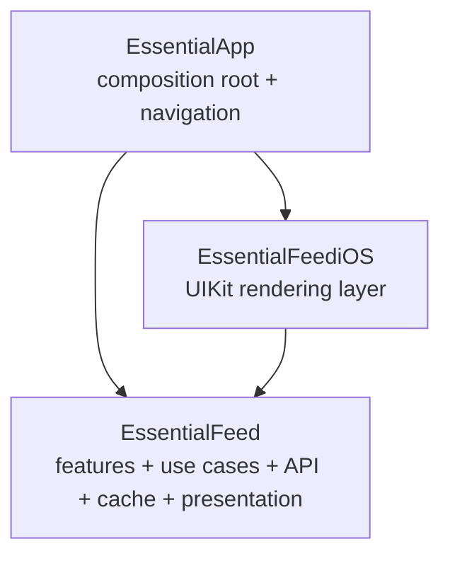

[](https://github.com/Adrimi/EssentialFeed/actions/workflows/CI-iOS.yml)
[](https://github.com/Adrimi/EssentialFeed/actions/workflows/CI-macOS.yml)
[](https://www.codefactor.io/repository/github/adrimi/essentialfeed)

# EssentialFeed

`EssentialFeed` is an iOS-focused sample app and modular codebase that demonstrates how to build a feature with strict boundaries between:

- app composition
- feature/business logic
- infrastructure
- presentation
- UIKit rendering
- tests at multiple levels

The app itself is intentionally small: it loads a remote image feed, paginates it, caches feed data and image data locally, and shows image comments. The interesting part is not the amount of UI, but how the code is structured so each concern can evolve and be tested independently.

## What This Repository Contains

At the root level, the repository is split into app code, reusable frameworks, and dedicated test targets:

```text
EssentialApp/                     iOS application composition root
EssentialFeed/                    shared feature logic, API, cache, presenters
EssentialFeediOS/                 UIKit-specific rendering layer
EssentialAppTests/                app composition and acceptance tests
EssentialFeedTests/               unit tests for feature/infrastructure/presentation
EssentialFeedAPIEndToEndTests/    real HTTP end-to-end tests
EssentialFeedCacheIntegrationTests/ Core Data integration tests
EssentialFeediOSTests/            snapshot tests for reusable iOS UI
EssentialApp.xcworkspace          main workspace for day-to-day iOS work
EssentialFeed.xcodeproj           standalone project for framework/macOS schemes
```

## Architecture Overview

This project follows a layered, modular architecture with a dedicated composition root. The app is not a big MVC target. Instead, the app target wires together small pieces that already know how to do one thing well.

### Dependency Direction



The dependency rule is simple:

- `EssentialFeed` does not know about `UIKit` or the app.
- `EssentialFeediOS` knows how to render `EssentialFeed` view models using UIKit.
- `EssentialApp` owns all live wiring, navigation, and concrete runtime decisions.

That keeps the reusable code reusable, and it keeps the app target thin.

## Module Responsibilities

### `EssentialFeed`

This is the core module. It contains the building blocks of the feature, organized by responsibility instead of by screen:

- `Feed Feature`
  Defines domain models and abstractions such as `FeedImage`, `FeedCache`, `FeedImageDataLoader`, and `FeedImageDataCache`.
- `Image Comments Feature`
  Defines `ImageComment`.
- `Shared API` and `Feed API`
  Defines `HTTPClient`, pagination primitives, endpoints, and remote response mappers.
- `Feed Cache`
  Defines local cache policies, store protocols, and cache loaders.
- `Shared Presentation`, `Feed Presentation`, `Image Comments Presentation`
  Defines presenters, view models, loading/error contracts, and localized UI-facing text.

This is where most of the architecture lives.

### `EssentialFeediOS`

This is the reusable UIKit layer. It renders presentation models into real screens and cells without owning app-specific composition rules.

It includes:

- a generic `ListViewController` backed by a diffable data source
- `CellController` wrappers to compose heterogeneous table content
- feed image cell controllers
- load-more cell controllers
- image comments cell controllers
- storyboards and reusable views

The important detail is that this module renders state. It does not decide where data comes from.

### `EssentialApp`

This is the composition root. It is deliberately small and mostly lives in:

- `SceneDelegate.swift`
- `FeedUIComposer.swift`
- `CommentsUIComposer.swift`
- `FeedViewAdapter.swift`
- `LoadResourcePresentationAdapter.swift`

This target decides:

- which concrete `HTTPClient` to use
- which concrete store to use
- how remote and local loaders are combined
- how navigation works
- which screen is shown first

The app target is where the live object graph is built.

## The Main Architectural Ideas

### 1. Composition Root Over Global Coupling

`SceneDelegate` is the runtime assembly point for the app.

It creates:

- `URLSessionHTTPClient` as the live networking implementation
- `CoreDataFeedStore` as the live persistence implementation
- `LocalFeedLoader` for feed caching and cache validation
- `NullStore` as a safe fallback if the persistent store cannot be created
- feed and comments screens via composers

This is important because feature code does not instantiate its own dependencies. Instead, the outer layer supplies dependencies from the edge.

### 2. Features Are Driven by Protocols and Models

The core module exposes protocols such as:

- `HTTPClient`
- `FeedStore`
- `FeedImageDataStore`
- `FeedCache`
- `FeedImageDataLoader`
- `FeedImageDataCache`

This allows infrastructure details to be swapped without changing business logic or UI composition. The tests take full advantage of this by using spies, stubs, in-memory stores, and integration stores depending on what is being verified.

### 3. Presentation Is Separated From Rendering

The project uses a clear split between:

- presenters and view models in `EssentialFeed`
- UIKit controllers and cells in `EssentialFeediOS`

Examples:

- `FeedPresenter` maps `[FeedImage]` into a `FeedViewModel`
- `FeedImagePresenter` maps a `FeedImage` into a `FeedImageViewModel`
- `ImageCommentsPresenter` formats dates and produces comment view models
- `LoadResourcePresenter` coordinates loading, mapping, loading state, and error state

UIKit code receives already-prepared view models rather than raw domain objects plus formatting logic.

### 4. Generic Resource Loading Instead of Per-Screen Boilerplate

One of the strongest ideas in this codebase is the reusable loading flow built around:

- `LoadResourcePresentationAdapter`
- `LoadResourcePresenter`
- `ResourceView`
- `ResourceLoadingView`
- `ResourceErrorView`

That combination gives feed loading, image loading, load-more, and comments loading the same lifecycle:

1. start loading
2. clear previous error
3. render loading state
4. map result into a view model
5. render success or error
6. cancel safely when the owning UI goes away

Instead of writing a custom controller presenter pair for every asynchronous resource, the project reuses the same generic pipeline.

### 5. UIKit Is Composed From Small Cell Controllers

The feed screen is not a giant `UITableViewController` with many `switch indexPath` branches.

Instead:

- `ListViewController` owns the table view and diffable data source
- each row is represented by a `CellController`
- each cell controller owns its own table-view callbacks

This keeps reusable list infrastructure generic while letting feature-specific behavior live in dedicated row controllers such as:

- `FeedImageCellController`
- `LoadMoreCellController`
- `ImageCommentCellController`

This also makes prefetching and cancellation much easier to reason about.

### 6. Infrastructure Lives at the Edge

Remote and local details are pushed to concrete implementations:

- `URLSessionHTTPClient` handles HTTP
- `FeedItemsMapper`, `FeedImageDataMapper`, and `ImageCommentsMapper` validate and decode server responses
- `CoreDataFeedStore` persists cache state
- `LocalFeedLoader` and `LocalFeedImageDataLoader` implement local use cases on top of store protocols

The rest of the app depends on abstractions and models rather than on `URLSession` or Core Data APIs directly.

### 7. Concurrency Is Explicit

The codebase uses Swift concurrency at async boundaries:

- loaders are `async throws`
- UI adapters create `Task`s for loading resources
- result delivery is marshaled back to the main actor before touching views
- in-flight work is canceled when the owning UI deinitializes or a cell goes off-screen

This is especially visible in `LoadResourcePresentationAdapter`, which prevents duplicate requests, tracks active tasks, and safely ignores stale completions.

## End-to-End Runtime Flows

### Feed Loading

When the feed screen appears:

1. `ListViewController` triggers `onRefresh`
2. `FeedUIComposer` forwards that to a `LoadResourcePresentationAdapter`
3. the adapter asks its loader for `Paginated<FeedImage>`
4. in the live app, `SceneDelegate` first tries the remote feed endpoint
5. remote data is mapped into `[FeedImage]`
6. successful remote results are cached with `LocalFeedLoader`
7. if remote loading fails, the app falls back to locally cached feed items
8. `LoadResourcePresenter` maps the loaded resource into UI-ready models
9. `FeedViewAdapter` builds the feed cells and optional load-more cell
10. `ListViewController` applies a diffable snapshot

That is a full vertical slice from view event to infrastructure and back without mixing responsibilities across layers.

### Pagination

Pagination is modeled explicitly through `Paginated<Item>`, which contains:

- the current items
- an optional `loadMore` closure that produces the next page

This is a nice architectural choice because the UI does not need to know about page numbers or cursor formats. It only knows whether more content can be requested.

### Feed Image Loading

Each feed cell requests its own image through `FeedImageCellController`.

The live image pipeline works like this:

1. try `LocalFeedImageDataLoader`
2. if not found, fetch remotely through `HTTPClient`
3. validate remote data with `FeedImageDataMapper`
4. cache successful image data locally
5. render the image

When cells disappear or prefetching is canceled, image requests are canceled as well.

### Comments Loading

Comments use the same generic loading pipeline as feed loading, but with a simpler data source:

- comments are loaded remotely
- `ImageCommentsMapper` decodes them
- `ImageCommentsPresenter` formats the dates into relative strings
- `CommentsViewAdapter` turns them into comment cells

This is a good example of how the architecture stays consistent even when a feature has different data requirements.

### Cache Validation

When the app is about to move out of the active state, `SceneDelegate` asks `LocalFeedLoader` to validate the cache.

The feed cache policy currently keeps items for 7 days. Expired cache entries are deleted. This keeps persistence concerns out of the UI layer while still tying cleanup to a meaningful application lifecycle event.

## A Guided Tour Of Key Files

If you want to understand the project quickly, start here:

- `EssentialApp/SceneDelegate.swift`
  The live composition root and the best place to understand the full object graph.
- `EssentialApp/FeedUIComposer.swift`
  Shows how a feature screen is assembled from loaders, presenters, proxies, and adapters.
- `EssentialApp/FeedViewAdapter.swift`
  Bridges paginated feed data into cell controllers and load-more behavior.
- `EssentialApp/LoadResourcePresentationAdapter.swift`
  The async loading adapter that handles task lifetime, duplicate-load prevention, and cancellation.
- `EssentialApp/WeakRefVirtualProxy.swift`
  Prevents presentation components from strongly retaining UIKit views.
- `EssentialFeed/Shared Presentation/LoadResourcePresenter.swift`
  The generic presentation pipeline for loading/error/success states.
- `EssentialFeed/Feed Cache/LocalFeedLoader.swift`
  Encapsulates feed cache save/load/validation use cases.
- `EssentialFeed/Feed Cache/Infrastructure/CoreData/CoreDataFeedStore.swift`
  The concrete persistence implementation.
- `EssentialFeediOS/Shared UI/Controllers/ListViewController.swift`
  The generic reusable list renderer for feed and comments.
- `EssentialFeediOS/Feed UI/Controllers/FeedImageCellController.swift`
  A good example of cell-level UI orchestration with request/cancel behavior.

## Test Strategy

The repository uses several layers of tests, each aimed at a different risk.

### `EssentialFeedTests`

These are focused unit tests for the core module:

- API mappers
- endpoint generation
- local feed loader behavior
- image data cache behavior
- Core Data store specs
- presenters and localization
- `URLSessionHTTPClient`

This layer verifies correctness of the domain, presentation, and infrastructure contracts in isolation.

### `EssentialFeediOSTests`

These are snapshot tests for the reusable UIKit module.

They verify:

- feed rendering
- load-more states
- failed image loading states
- comments rendering
- shared list/error states
- light and dark mode
- large accessibility text sizes

This makes visual regressions easier to catch without coupling UI assertions to the app target.

### `EssentialAppTests`

These are integration and acceptance tests over the real composition layer.

They verify:

- the composed feed UI
- image loading behavior and cancellation
- load-more behavior
- comments screen composition
- cache fallback behavior
- navigation from feed to comments
- app lifecycle-driven cache validation

This is where the architecture proves that its independently tested pieces still work together as a whole.

### `EssentialFeedAPIEndToEndTests`

These hit a real remote test server to verify that the app can decode real responses, not just hand-crafted fixtures.

### `EssentialFeedCacheIntegrationTests`

These verify that the Core Data-backed store behaves correctly across separate loader instances and real persistence boundaries.

## Why The Architecture Works Well

This project stays maintainable because it enforces a few practical rules:

- UI does not know networking details.
- networking does not know UIKit details.
- persistence does not leak into controllers.
- formatting lives in presenters instead of views.
- the app target composes; it does not own business rules.
- features depend on protocols and models, not concrete outer-layer implementations.
- each layer is testable without booting the entire app.

The result is a codebase where adding a new screen or swapping an implementation tends to affect one layer at a time rather than requiring broad rewrites.

## Working With The Project

### Open The Right Entry Point

For normal iOS app work, open:

```text
EssentialApp.xcworkspace
```

For the standalone framework/macOS project, use:

```text
EssentialFeed.xcodeproj
```

### Useful Schemes

The repository currently exposes these main schemes:

- `EssentialApp`
- `CI_iOS`
- `CI_macOS`
- `EssentialFeed`
- `EssentialFeediOS`
- `EssentialFeedAPIEndToEndTests`
- `EssentialFeedCacheIntegrationTests`

### Build And Test

This repository is Xcode-based. Use `xcodebuild`, not SwiftPM commands.

Examples:

```bash
xcodebuild -workspace EssentialApp.xcworkspace -scheme EssentialApp
```

```bash
xcodebuild -workspace EssentialApp.xcworkspace -scheme CI_iOS -sdk iphonesimulator -destination 'platform=iOS Simulator,name=<Installed Simulator>' clean build test
```

```bash
xcodebuild -project EssentialFeed.xcodeproj -scheme CI_macOS -sdk macosx -destination 'platform=macOS' clean build test
```

The CI workflows in `.github/workflows/CI-iOS.yml` and `.github/workflows/CI-macOS.yml` are a good reference for automated validation.

## Localization

The presentation layer contains localized strings for:

- English
- Polish
- Greek
- Brazilian Portuguese

Localization lives close to the presentation types that use it, which keeps the ownership of UI copy clear.

## Extending The Project

If you want to add a new resource-driven feature and stay consistent with the existing architecture, the usual path is:

1. Define feature models and protocols in `EssentialFeed`.
2. Add remote/local implementations and mappers in the appropriate API or cache folders.
3. Add presentation models/presenters in `EssentialFeed`.
4. Add UIKit rendering pieces in `EssentialFeediOS`.
5. Compose the screen in `EssentialApp` with a composer and live dependencies.
6. Cover the change with unit, integration, and snapshot tests at the appropriate layers.

The codebase is designed so new features can reuse the same loading and presentation patterns instead of inventing a new architecture for each screen.

## Summary

`EssentialFeed` is a compact example of a modular iOS app where:

- the app target is just the composition root
- reusable feature logic lives outside the app
- presentation is decoupled from rendering
- remote and local data concerns are explicit
- UIKit screens are assembled from small controllers
- tests validate the system from pure units up to end-to-end flows

If your main goal is to understand the architecture, start with `SceneDelegate`, then follow the path into the composers, generic loading pipeline, core module use cases, and finally the reusable `EssentialFeediOS` renderers.
